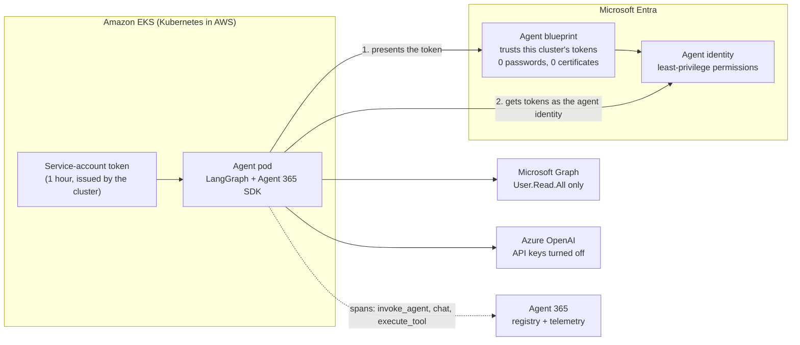

# LangGraph agent on Kubernetes (Amazon EKS) with the Agent 365 SDK

Run an open-source **LangGraph** AI agent on **Amazon EKS** (Kubernetes in AWS), give it a real **Microsoft Entra agent identity** with **no stored password, key or certificate**, wrap it with the **Microsoft Agent 365 SDK** so it is registered and observable in Agent 365, and then **delete the whole AWS side when you are not using it** so it costs nothing.

This guide assumes you are **not** an AWS or Linux person. Every command is copy and paste, every portal click is spelled out, and every step says what you should see when it worked. If you would rather have an AI agent do the work, use the prompts in [`PROMPTS.md`](PROMPTS.md).

> **Demo, not production guidance.** It is built to show a control working clearly. Several of the Microsoft features used are in **Preview**, so names and screens can change. Links to the Microsoft Learn pages are at the end.

---

## What you will build



**The one-sentence message:** an open-source agent can run on any Kubernetes cluster, get a real Entra identity with no stored secret, and be governed through Agent 365.

What the finished demo proves:

1. The pod has **no secret** anywhere (no Kubernetes Secret, no key in the environment). It proves who it is with a short-lived token that Kubernetes issues, which Entra has been told to trust.
2. The agent calls **Azure OpenAI** and **Microsoft Graph as itself**. API keys on the Azure OpenAI account are switched off, so the identity is the only way in.
3. **Least privilege** is enforced by Entra: asking for a person works, asking to list directory groups is refused (HTTP 403).
4. The Agent 365 SDK emits **telemetry spans** (`invoke_agent`, `chat`, `execute_tool`) and the agent is **registered** in the Agent 365 registry.

---

## Plain-English glossary

| Word | What it means |
|---|---|
| **Kubernetes** | Software that runs your program in a "container" and restarts it if it stops. |
| **Cluster** | The group of computers Kubernetes manages. Ours has one worker computer. |
| **EKS** | Amazon's managed Kubernetes. AWS runs the control plane, you rent the worker computer. |
| **Node** | One worker computer in the cluster. |
| **Pod** | One running copy of the agent. |
| **Namespace** | A folder inside the cluster. Ours is `a365-agents`. |
| **Service account** | The agent's login name inside the cluster. Ours is `langgraph-agent`. |
| **ConfigMap** | A settings file stored in the cluster. Ours holds only IDs and web addresses. |
| **Kubernetes Secret** | Where passwords normally go. **Ours is empty on purpose.** |
| **`kubectl`** | The command-line tool that talks to a cluster (say "cube control"). |
| **Agent blueprint** | An Entra object that defines a kind of agent and holds the trust settings. |
| **Agent identity** | The Entra identity of one running agent, created from the blueprint. |
| **Federated credential** | A setting on the blueprint that says "trust tokens issued by this cluster for this service account". This is what replaces a password. |
| **Span / telemetry** | A record of what the agent did, such as "started a run", "called the model", "used a tool". |

---

## Time and cost

| | |
|---|---|
| Setup, first time | about 2 to 3 hours, most of it waiting for AWS |
| **Rebuild** the AWS side after you deleted it | **about 15 to 40 minutes** (14 minutes in my test run), one command |
| Cost **while the cluster exists** | about **$0.26 an hour** (about **$190 a month** if left running) |
| Cost **after you delete it** | **about $0** |
| Azure OpenAI | cents for a demo |

AWS prices below are list prices for a US region and change over time, so check the AWS pricing pages. The cluster costs money for every hour it exists, even when nobody is using it, so **[delete it when you are done](#keep-the-cost-down-delete-it-and-set-it-up-again)**.

---

## Before you start

### Accounts and roles you need

| You need | Why | Notes |
|---|---|---|
| A **Microsoft Entra tenant** with Agent 365 / Entra Agent ID available | To create the blueprint, agent identity and registry entry | Agent 365 was in Preview when this was written. Use a lab tenant, not production. |
| Entra roles: **Agent ID Administrator** (or Agent ID Developer plus ownership), and **Privileged Role Administrator** or **Global Administrator** | Create the blueprint and agent identity, and grant the Microsoft Graph permission | A Global Administrator in a lab tenant covers everything. |
| An **Azure subscription** where you are **Owner** (or Contributor plus User Access Administrator) | Create the Azure OpenAI account and give the agent a role on it | |
| An **AWS account** with permission to create EKS clusters, EC2 and VPCs | Build the cluster | `AdministratorAccess` is the simplest. If your account has restrictions, see [Troubleshooting](#troubleshooting). |
| A **Windows 10/11 PC** with internet access and permission to install software | Run the commands | The scripts are PowerShell. |

### What gets installed on your PC (by the setup script)

Azure CLI, AWS CLI, `kubectl` and `eksctl`. You do **not** need Docker, Linux, WSL or any AWS knowledge.

### Settings you will collect as you go

You will copy a handful of IDs into one settings file (`scripts\config.ps1`) so you never have to type them again: tenant ID, blueprint ID, agent identity ID, Azure OpenAI name and endpoint, and the AWS region. The file is git-ignored, so it is never published.

---

## Step 1. Get the files and open a terminal

1. Get this repository onto your PC. Either install Git and run
   `git clone https://github.com/stscholz914/steves-agent-security-demo-build.git`, or on the GitHub page choose **Code > Download ZIP** and unzip it.
2. Open **File Explorer** and go into the folder `langgraph-agent365-kubernetes-demo`.
3. Click in the address bar, type `powershell` and press **Enter**. A blue PowerShell window opens already in that folder.

   Or: press the **Windows key**, type `Terminal`, press Enter, then `cd` to the folder:

   ```powershell
   cd "C:\path\to\steves-agent-security-demo-build\langgraph-agent365-kubernetes-demo"
   ```
4. Allow the scripts to run in this window (this lasts only until you close it and needs no administrator rights):

   ```powershell
   Set-ExecutionPolicy -Scope Process -ExecutionPolicy Bypass -Force
   Unblock-File .\scripts\*.ps1
   ```

> **Tip:** every time you install a tool, close the window and open a **new** one. Windows only applies new tools to windows opened afterwards. If a command says `not recognized`, this is almost always why.

---

## Step 2. Install the tools

Open PowerShell **as administrator** for this one step: press the Windows key, type `PowerShell`, right-click **Windows PowerShell**, choose **Run as administrator**. Then:

```powershell
cd "C:\path\to\steves-agent-security-demo-build\langgraph-agent365-kubernetes-demo"
Set-ExecutionPolicy -Scope Process -ExecutionPolicy Bypass -Force
.\scripts\setup-device.ps1
```

It installs only what is missing and finishes in a few minutes. **Expect** version numbers for kubectl, eksctl, the AWS CLI and the Azure CLI, ending with `Setup complete`.

Close the administrator window. Open a **new, normal** PowerShell window in the same folder (Step 1, items 3 and 4) and check:

```powershell
az version --output tsv | Select-Object -First 1
aws --version
kubectl version --client
eksctl version
```

Every line should print a version, not an error.

> **On a company PC behind a security proxy?** If later steps fail with `CERTIFICATE_VERIFY_FAILED` or `x509: certificate signed by unknown authority`, see [Troubleshooting](#troubleshooting). The setup script already handles the most common case (Microsoft Entra Global Secure Access TLS inspection).

---

## Step 3. Create your settings file

```powershell
Copy-Item .\scripts\config.example.ps1 .\scripts\config.ps1
notepad .\scripts\config.ps1
```

Leave the file open. You will fill in the values as you collect them in the next steps. Save it each time you add something.

---

## Step 4. Sign in to Azure and AWS

### Azure

```powershell
az login --tenant <YOUR_TENANT_ID>
```

A browser opens. Sign in with an account that has the roles above. **Find your tenant ID** at the [Entra admin center](https://entra.microsoft.com) under **Entra ID > Overview**, copy **Tenant ID**, and paste it into `config.ps1` as `DEMO_TENANT_ID`.

If `az login` picks the wrong subscription, list and choose one:

```powershell
az account list --query "[].{name:name,id:id,default:isDefault}" -o table
az account set --subscription "<SUBSCRIPTION_NAME_OR_ID>"
```

### AWS

```powershell
aws login --region us-east-2
```

A browser page opens. **Sign in to the AWS account you want to use** and approve the request. Then check who you are:

```powershell
aws sts get-caller-identity --query Arn --output text
```

**Expect** a line containing your 12-digit AWS account number.

> **Wrong AWS account?** The browser may silently reuse an old AWS session. Sign out at `https://signin.aws.amazon.com/oauth2/logout`, then run `aws login` again. If the terminal asks `Do you want to overwrite ... (y/n)`, type `y`.
>
> **Which region?** Use a region your account is allowed to use. Some company AWS accounts only allow certain regions. `us-east-2` (Ohio) is the default here. If you choose another, put it in `config.ps1` as `DEMO_AWS_REGION` and use it in every `aws login`.
>
> **AWS sign-ins expire** after a while. If a command says `Your session has expired`, just run `aws login` again.

---

## Step 5. Create the Azure OpenAI account (the model the agent calls)

Pick a **globally unique** name of 3 to 24 lowercase letters and digits, for example `myname365demo`.

```powershell
.\scripts\10-create-azure-openai.ps1 -AccountName <UNIQUE_NAME>
```

This creates a resource group, an Azure OpenAI account, a `gpt-4.1-mini` deployment, and **turns API keys off** so only an Entra identity can call it. It takes about 2 minutes.

**Expect** it to end with four lines starting `$env:DEMO_OPENAI_...`. **Copy those four lines into `config.ps1`** replacing the placeholders, and save.

If it fails: the name is taken (choose another), or you have no quota for the model in that region (use `-Location swedencentral` or lower `-Capacity 10`).

---

## Step 6. Create the agent blueprint and the agent identity (in the Entra admin center)

You do this part by clicking, using Microsoft's own wizards.

### 6a. Create the blueprint

1. Go to <https://entra.microsoft.com> and sign in.
2. In the left menu choose **Entra ID > Agents > Agent blueprints**.
3. Click **New agent blueprint (Preview)**.
4. **Name:** `LangGraph Blueprint`. Click **Next**.
5. **Owners & Sponsors:** keep yourself (a sponsor is required). Click **Next**, then **Create**, then **Go to agent blueprint**.
6. On the blueprint page, copy the **Application (client) ID** into `config.ps1` as `DEMO_BLUEPRINT_APP_ID` and the **Object ID** as `DEMO_BLUEPRINT_OBJECT_ID`. (For agent blueprints these two can be the same value.)

> **Do not add a client secret or certificate.** The whole point is that there is none. Trust is added in Step 9.

### 6b. Create the agent identity

1. In the left menu choose **Entra ID > Agents > Agent identities**.
2. Click **New agent identity (Preview)**.
3. **Agent blueprint:** choose `LangGraph Blueprint`. **Name:** `LangGraph Agent (Amazon EKS)`. Click **Next**.
4. Keep the owner and sponsor. Click **Next**, then **Create**, then **Go to agent identity**.
5. Copy the identity's **Object ID** into `config.ps1` as `DEMO_AGENT_ID`. (For agent identities this is the same value as the application ID.)

Save `config.ps1`.

---

## Step 7. Give the agent only the permissions it needs

```powershell
. .\scripts\config.ps1
.\scripts\20-grant-agent-access.ps1
```

This grants the agent identity exactly two things:

| Permission | Lets it |
|---|---|
| Microsoft Graph **User.Read.All** (application permission) | look people up in the directory |
| Azure role **Cognitive Services OpenAI User** on your OpenAI account only | call the model |

It deliberately does **not** grant any group permission, which is what lets the demo show a refusal.

**Expect** `Granted.` (or `Already granted.`) and `Done`. Azure role assignments can take a few minutes to take effect.

---

## Step 8. Register the agent in Agent 365

Without this the Agent 365 telemetry exporter is rejected with HTTP 403.

```powershell
.\scripts\30-register-agent.ps1
```

It uses **device code** sign-in: the terminal prints a short code and a link (`microsoft.com/devicelogin`). Open the link, enter the code, and sign in with the same admin account. (PowerShell 7 and `Install-Module Microsoft.Graph.Authentication -Scope CurrentUser` are needed once; the script tells you if they are missing.)

**Expect** `Registered: <an ID>`. If it says the agent is already registered, that is fine.

You can see it afterwards in the Microsoft 365 admin center under **Agents > Registry**.

---

## Step 9. Build the AWS side and deploy the agent

This is the long, automatic part. It is also the command you run again every time you want the demo back after deleting it.

```powershell
. .\scripts\config.ps1
.\scripts\60-rebuild-eks.ps1
```

It takes **about 15 to 40 minutes** (14 minutes in my last test run; AWS is sometimes slower). You can leave it running. It prints a heading for each stage and **skips anything already done**, so it is safe to run again if it stops partway.

| Stage | What is happening | Typical time |
|---|---|---|
| 1. Cluster | AWS creates the Kubernetes control plane | about 10 min |
| 2. Add-ons | Network, proxy and DNS components | 1 to 2 min |
| 3. Node | AWS starts one worker computer | 3 to 10 min |
| 4. kubectl | Your PC is connected to the cluster | seconds |
| 5. Entra trust | **Adds a federated credential to the blueprint** using this cluster's address | seconds |
| 6. Deploy | Starts the agent pod (it downloads its Python packages the first time) | 2 to 4 min |
| 7. Smoke test | Asks the pod who it is | seconds |

**Expect** at the end: a pod showing `1/1 Running` and a block of JSON showing the identity. In that JSON look for:

- `pod_service_account_token` > `iss`: your **cluster's** address (`https://oidc.eks.<region>.amazonaws.com/id/...`)
- `graph_token` > `iss`: **Microsoft Entra** (`https://sts.windows.net/<tenant>/`)
- `graph_token` > `appid`: **your agent identity**, and `roles`: only `User.Read.All`

That is the secretless login working.

---

## Step 10. Run the demo

Load the short helper commands (once per window), then run them one at a time:

```powershell
. .\scripts\config.ps1
. .\scripts\demo-helpers.ps1
Test-DemoReady     # AWS sign-in, node Ready, pod Running
Show-NoSecrets     # proves there is no secret in the cluster
Show-Identity      # the badge and the tokens Entra returned
Ask-Agent          # one allowed tool call, one refused
Show-Spans         # the Agent 365 SDK telemetry
```

What each one proves:

| Command | You should see | Meaning |
|---|---|---|
| `Show-NoSecrets` | `No resources found`, `(none)` for credential-looking variables, and a ConfigMap of IDs only | There is no password, key or certificate in the cluster. |
| `Show-Identity` | The three tokens described in Step 9 | Entra trusted the cluster's token and issued the agent identity's tokens. |
| `Ask-Agent` | An answer that gives a person's job title, then says listing groups was **denied (403)** | Allowed tool worked, forbidden tool was refused by Entra, not by the agent's good manners. |
| `Show-Spans` | Lines for `invoke_agent`, `chat`, `execute_tool ...`, then `(none)` under export errors | The Agent 365 SDK is emitting telemetry and delivering it without errors. |

In the portals:

- **Entra admin center > Entra ID > Agents > Agent blueprints > your blueprint > Credentials:** no secrets or certificates, one federated credential named `eks-langgraph-sa`.
- **Microsoft 365 admin center > Agents > Registry:** search `LangGraph` to see the registered agent.
- **AWS console** (`https://console.aws.amazon.com`, make sure the region at top right matches yours) **> EKS > Clusters > a365-demo:** the cluster's **OpenID Connect provider URL** is the same address you saw as `iss`.

> **Honest limits to say out loud:** the Agent 365 SDK in this setup gives the agent identity and observability. It does **not** add runtime blocking or per-call authorization inside the agent; that comes from Entra permissions, Defender and Purview. I have not confirmed that the telemetry appears in the Agent 365 portal screens, so preview that yourself before showing it live. The exporter reporting no errors is what is proven here.

---

## Keep the cost down: delete it and set it up again

The cluster bills **about $0.26 an hour for as long as it exists**, whether or not anyone is using it. The cheapest habit is **delete it when you finish and rebuild it about an hour before the next demo.**

### The three states

| State | AWS cost | Time to get the demo back | When to use it |
|---|---|---|---|
| **Running** | about $0.26/hour (about $190/month) | already there | during a demo |
| **Paused** (node stopped, cluster kept) | about $0.15/hour (about $110/month): the control plane and NAT gateway still bill | about 5 to 10 minutes | between demos on the same day or week |
| **Deleted** | **about $0** | about 15 to 40 minutes (one command) | any time you will not use it for a day or more |

### Delete everything in AWS (cost goes to about $0)

```powershell
. .\scripts\config.ps1
.\scripts\62-delete-eks.ps1
```

Type `DELETE` when asked. It takes **about 10 to 15 minutes** (11 minutes in my test run) and shows progress as it goes. The script:

1. removes the agent, the worker node, the cluster and the network AWS created for it (including the **NAT gateway**, the most expensive hidden item),
2. switches off the CloudFormation protection some AWS accounts add to those stacks,
3. falls back to deleting the CloudFormation stacks directly if `eksctl` cannot reach the cluster (for example behind a security proxy), and
4. **checks the whole region** for anything still billable and prints a green `AWS cost is about $0` when it is clean.

Check at any time, without deleting anything:

```powershell
.\scripts\62-delete-eks.ps1 -VerifyOnly
```

**Expect** `Nothing billable found in <region> ... AWS cost is about $0`. If it lists anything, run the delete again; it is safe to repeat. For a stray item, delete it in the AWS console in that region.

**What is kept** after a delete: the Entra blueprint and agent identity, the registry entry, the Azure OpenAI account and the permissions. They cost nothing meaningful. Nothing about the agent identity changes, so you do not repeat Steps 5 to 8.

### Set it up again

When you want the demo back, start **about an hour ahead**:

```powershell
aws login --region <your region>
. .\scripts\config.ps1
.\scripts\60-rebuild-eks.ps1
```

The same script from Step 9 builds everything again. One thing is different from the first run: a **new cluster has a new address**, so the script **replaces the Entra federated credential** with one for the new address automatically. Nothing else needs doing. When it ends with the identity JSON, run `Test-DemoReady`.

### Pause instead of delete (same day or week)

```powershell
.\scripts\61-scale-eks.ps1 -Nodes 0    # pause: stops the worker node (about 1 minute)
.\scripts\61-scale-eks.ps1 -Nodes 1    # resume: ready in 5 to 10 minutes, the agent restarts by itself
```

Pausing saves the worker node and its disk but **not** the control plane or NAT gateway. If you will not need it for a day or more, delete instead.

### A routine that keeps the bill near zero

| When | Do this |
|---|---|
| About an hour before a demo | `aws login`, then `.\scripts\60-rebuild-eks.ps1` |
| Just before | `Test-DemoReady` |
| Right after the demo | `.\scripts\62-delete-eks.ps1` |
| Then | `.\scripts\62-delete-eks.ps1 -VerifyOnly` and confirm `AWS cost is about $0` |
| Once | Create an **AWS budget alert**: console > **Billing and Cost Management > Budgets > Create budget**, a monthly cost budget of about **$25 to $50** with an email alert at 80 percent. It will warn you if you forget to delete. |
| Optional | Ask Scout to remind you or check weekly ([prompts](PROMPTS.md)). |

> **The easiest way to overspend is forgetting.** A cluster left running costs about $6 a day.

---

## How the Agent 365 SDK is wired in

The agent is in [`agent/app.py`](agent/app.py) and the secretless sign-in is in [`agent/identity.py`](agent/identity.py). It follows Microsoft's [`observability-with-langgraph` sample](https://github.com/microsoft/Agent365-Samples/tree/main/python/observability-with-langgraph). The five steps:

1. **Set up OpenTelemetry** as you normally would (here a console exporter, so spans show in the pod logs).
2. **`configure(...)`** from `microsoft-agents-a365-observability-core` adds the **Agent 365 exporter** to that same provider.
3. **`CustomLangChainInstrumentor()`** from `microsoft-agents-a365-observability-extensions-langchain` automatically records every LangChain/LangGraph model call and tool call as spans. Run it **after** `configure()`.
4. **Build the agent normally** with `create_react_agent`. No telemetry code is needed inside it.
5. **Wrap each run in `InvokeAgentScope`** and call `force_flush()` so the spans are sent.

**The one change from the Microsoft sample:** the sample's telemetry token uses a blueprint client secret (flagged development only). `identity.py` replaces that with the Kubernetes token exchange, so no secret exists anywhere:

1. Kubernetes projects a token into the pod (audience `api://AzureADTokenExchange`, valid one hour, issued by the cluster).
2. The pod sends it to Entra as the blueprint's `client_assertion` with `fmi_path` set to the agent identity. Entra checks **issuer, subject and audience** against the blueprint's federated credential and returns a first token.
3. The agent identity presents that token and receives tokens for Microsoft Graph, Azure OpenAI and the Agent 365 observability service.

### Make it your own agent

Edit the two `@tool` functions in `agent/app.py`, or add your own, and re-run `.\scripts\60-rebuild-eks.ps1`. The script re-uploads the code and restarts the pod. Grant the agent identity only the extra permissions the new tools need, and update `20-grant-agent-access.ps1` to match.

The deployment uses a stock Python image with the code mounted from a ConfigMap, so **you never need Docker**. If you would rather build your own image, there is an optional [`agent/Dockerfile`](agent/Dockerfile).

---

## Troubleshooting

| What you see | What it means and what to do |
|---|---|
| `... is not recognized` for `aws`, `az`, `kubectl` or `eksctl` | The tool is not on this window's PATH. Close the window and open a **new** one. If still missing, re-run `scripts\setup-device.ps1` as administrator. |
| `running scripts is disabled on this system` | Run `Set-ExecutionPolicy -Scope Process -ExecutionPolicy Bypass -Force` in that window. |
| `Missing value for DEMO_...` | A setting in `scripts\config.ps1` is blank. Fill it in, save, and run `. .\scripts\config.ps1`. |
| `Your session has expired` (AWS) | Run `aws login --region <your region>` again. |
| The browser keeps using the wrong AWS account | Sign out at `https://signin.aws.amazon.com/oauth2/logout`, then `aws login` again. |
| `explicit deny in a service control policy` | Your AWS organisation only allows certain regions or services. Set `DEMO_AWS_REGION` to an allowed region and sign in with `aws login --region <that region>`. |
| `SubscriptionRequiredException` or `OptInRequired` | The AWS account is new or not fully activated. Finish billing and phone verification and wait up to 24 hours. |
| `instance type is not eligible for Free Tier` | Set `DEMO_NODE_TYPE` to a type your plan allows (list them with `aws ec2 describe-instance-types --filters Name=free-tier-eligible,Values=true --region <region> --query "InstanceTypes[].InstanceType"`). |
| `CERTIFICATE_VERIFY_FAILED ... self-signed certificate in certificate chain` (AWS CLI or Azure CLI) | Your network re-signs HTTPS traffic (for example Entra Global Secure Access TLS inspection). The CLIs ignore the Windows certificate store. Run `.\scripts\fix-tls-inspection.ps1` as administrator, then open a **new** window. |
| `kubectl`: `x509: certificate signed by unknown authority` | Same cause. Run `.\scripts\fix-kubeconfig-tls.ps1`, then retry. If you administer the proxy, a bypass for `*.eks.amazonaws.com` fixes `kubectl` and `eksctl` for good. |
| `eksctl` fails the same way during build or delete | `eksctl` cannot be given extra certificates. For deleting, use `.\scripts\62-delete-eks.ps1 -UseCloudFormation`. For building, run it from a network without the proxy, or get the `*.eks.amazonaws.com` bypass. |
| The delete says `TerminationProtection is enabled` | The script turns that off for you. If you deleted by hand, run `aws cloudformation update-termination-protection --no-enable-termination-protection --stack-name <stack>` first. |
| Pod is `Pending` or the node is `NotReady` | The network add-ons are missing. Re-run `.\scripts\60-rebuild-eks.ps1`; it installs them. |
| `Show-Identity` fails with `AADSTS` or a token exchange error | Compare `iss` and `sub` in the pod token with the blueprint's federated credential. They must match exactly. Re-running the rebuild script recreates the credential. |
| `Ask-Agent` returns an authorization error for the model | The OpenAI role has not taken effect yet (wait 5 minutes) or step 7 was skipped. |
| Telemetry export errors (`HTTP 403`) in `Show-Spans` | The agent is not registered. Run `.\scripts\30-register-agent.ps1`. |
| `Ask-Agent` hangs more than a minute | Press **Ctrl+C**, wait 30 seconds, and run it again. The first call after a quiet period can be slow. |

---

## What is in this folder

| Path | What it is |
|---|---|
| [`README.md`](README.md) | This guide |
| [`PROMPTS.md`](PROMPTS.md) | Copy-paste prompts to have Scout (or another AI agent) build, run, and tear down all of this |
| [`agent/`](agent/) | `app.py` (LangGraph agent + Agent 365 SDK), `identity.py` (secretless Entra sign-in), optional `Dockerfile` |
| [`k8s/agent.yaml`](k8s/agent.yaml) | The Kubernetes manifest (placeholders filled in by the rebuild script) |
| [`scripts/setup-device.ps1`](scripts/setup-device.ps1) | Installs the tools |
| [`scripts/config.example.ps1`](scripts/config.example.ps1) | Your settings (copy to `config.ps1`) |
| [`scripts/10-create-azure-openai.ps1`](scripts/10-create-azure-openai.ps1) | Azure OpenAI, keys off |
| [`scripts/20-grant-agent-access.ps1`](scripts/20-grant-agent-access.ps1) | Least-privilege permissions |
| [`scripts/30-register-agent.ps1`](scripts/30-register-agent.ps1) | Agent 365 registry |
| [`scripts/60-rebuild-eks.ps1`](scripts/60-rebuild-eks.ps1) | **Build or rebuild** the AWS side and deploy |
| [`scripts/61-scale-eks.ps1`](scripts/61-scale-eks.ps1) | Pause or resume the worker node |
| [`scripts/62-delete-eks.ps1`](scripts/62-delete-eks.ps1) | **Delete** the AWS side and verify $0 |
| [`scripts/demo-helpers.ps1`](scripts/demo-helpers.ps1) | Short commands for running the demo |
| [`scripts/fix-tls-inspection.ps1`](scripts/fix-tls-inspection.ps1), [`scripts/fix-kubeconfig-tls.ps1`](scripts/fix-kubeconfig-tls.ps1) | Certificate fixes for networks that inspect HTTPS |

---

## Links

- [Create an agent identity blueprint](https://learn.microsoft.com/entra/agent-id/create-blueprint) and [create agent identities](https://learn.microsoft.com/entra/agent-id/create-delete-agent-identities) (Microsoft Learn)
- [Microsoft Agent 365 samples, `observability-with-langgraph`](https://github.com/microsoft/Agent365-Samples/tree/main/python/observability-with-langgraph)
- [Amazon EKS documentation](https://docs.aws.amazon.com/eks/) and [EKS pricing](https://aws.amazon.com/eks/pricing/)
- [`eksctl`](https://eksctl.io/)

*The build behind this guide was run end to end on 6 November 2026 on Amazon EKS (Kubernetes 1.34) with Python 3.12, LangGraph and the Agent 365 observability packages current at that time. On 10 November 2026 the generalised scripts in this folder were tested end to end under Windows PowerShell 5.1: Azure OpenAI creation, the permission grant, a full EKS rebuild from nothing (14 minutes, agent running with the expected identity, a refused permission and telemetry spans), and a full delete that verified the AWS cost was back to about $0 (11 minutes). The one part not repeated is creating a brand-new blueprint and agent identity through the portal wizards (Steps 6 to 8 were run earlier by script), so expect small differences in portal wording on your first run. The Microsoft Entra Agent ID and Agent 365 pieces were in Preview.*
