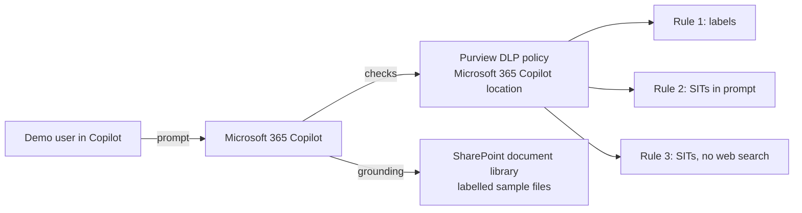

# Block Microsoft 365 Copilot from sensitive data with Purview DLP

A hands-on build guide. By the end, Microsoft 365 Copilot will **refuse to read files labelled Customer PII, M&A or HR**, **refuse prompts that contain a Social Security number or credit card number**, and **skip the web when a prompt contains a passport or driver's licence number**. Everything is proved in the Copilot chat window, with the same prompts used on both allowed and blocked content.

**Time:** about 2 hours of work, plus up to a day of waiting for labels to propagate (start the day before).
**Cost:** no new Azure or AWS resources. You need Microsoft 365 Copilot licences for the demo users.

---

## What this shows

| Control | Condition | What Copilot does |
|---|---|---|
| **Rule 1: labelled content** | File or email carries the label *Customer PII*, *Mergers and Acquisitions (MNPI)* or *HR* | Copilot does not open or use the item. It can still appear as a citation. |
| **Rule 2: sensitive prompts** | The text a user types contains a U.S. SSN or a credit card number | Copilot refuses to answer, and does not use the prompt for internal or web search. |
| **Rule 3: web search** | The prompt contains a passport number or U.S. driver's licence number | Copilot still answers from Microsoft 365 data, but does **not** send the prompt to web search. |

Two deliberate **controls** prove it is a targeted block, not Copilot being broken:

- A file labelled **Finance** is *not* in rule 1, so Copilot summarises it normally.
- **Public** and **General** files are summarised normally.

And one deliberate **gap** to discuss with the audience: a support transcript with a customer's SSN and card number pasted into the body has **no label**, so rule 1 does not stop it. DLP on labels only protects what is labelled.

### The pieces



---

## Prerequisites

- A **lab tenant** where you are Global Administrator (or Compliance Administrator plus Information Protection Administrator). Do not use production.
- **Microsoft 365 E5** (or E5 Compliance) and **Microsoft 365 Copilot** licences for at least two demo users.
- **Sensitivity labels turned on** for Microsoft 365 (default labels such as Public, General, Confidential and Highly Confidential exist). If you have never used labels, turn them on in the Purview portal first.
- A Windows machine with **PowerShell 7**, **Python 3.10+** and **git**.
- Your demo users each signed in to Copilot at least once.

---

## Constraints that decide the design (read first)

These come from Microsoft Learn and from my own build. They save the most time.

1. **A single DLP rule cannot use both a label condition and a sensitive-information-type condition.** That is why there are separate rules for labels (rule 1) and SITs (rules 2 and 3), all in the same policy.
2. **The Microsoft 365 Copilot location is Custom-template only**, and when you pick it every other location (Exchange, SharePoint and so on) is switched off for that policy.
3. **Files uploaded into a prompt are not scanned.** DLP only checks the text typed in the prompt. Say this out loud in the demo.
4. **In Word, Excel and PowerPoint the label check happens when the file is opened.** A label applied mid-session is enforced from the next open.
5. **Policies and labels take time to reach Copilot.** After enabling, allow up to about an hour. Newly published labels can take up to 24 hours to reach every app.
6. **Rule 3 (web search) and rule 2 (prompts) behave differently.** Rule 2 blocks the whole answer. Rule 3 only removes the web as a source.
7. **Prompt blocking was in Preview when this was built** (10 November 2026). Check the Microsoft Learn page in [Further reading](#further-reading) if behaviour differs.

---

## Part 1: Get the files and set your values

```powershell
git clone https://github.com/stscholz914/steves-agent-security-demo-build
cd steves-agent-security-demo-build\purview-copilot-dlp-demo\scripts
Copy-Item config.example.ps1 config.ps1
notepad config.ps1
```

Fill in your tenant domain, tenant ID, and the two demo users' UPNs and object IDs. To get an object ID:

```powershell
az ad user show --id <USER_UPN> --query id -o tsv
```

`config.ps1` is git-ignored so your values never reach the repo.

---

## Part 2: Create the sensitivity labels

Connect, then create and publish the labels:

```powershell
. .\00-connect.ps1
.\10-create-labels.ps1
```

This creates four labels as sublabels of the tenant's default parents:

| Label | Parent | Used for |
|---|---|---|
| Customer PII | Highly Confidential | The customer export. **Blocked by rule 1.** |
| Mergers and Acquisitions (MNPI) | Highly Confidential | The acquisition plan. **Blocked by rule 1.** |
| HR | Confidential | Salary bands. **Blocked by rule 1.** |
| Finance | Confidential | The forecast. **Not blocked** (the control). |

The script then publishes them in a label policy called **AI Demo - Sensitivity labels** to the demo users.

**Verify**

```powershell
Get-Label | Where-Object Name -like "AID-*" | Select-Object DisplayName, Name, Guid
```

You should see four rows. Keep the **Guid** column handy: those are the values rule 1 matches on, and they are different in every tenant.

> If a parent label is not found, create *Highly Confidential* or *Confidential* in the Purview portal under **Information Protection > Labels**, then re-run.

---

## Part 3: Create the sample data and label it

Everything here is **synthetic**. The Social Security numbers, card numbers and names are generated. The card numbers pass the Luhn check so the DLP classifier recognises them.

### 3.1 Generate the files

```powershell
cd ..\data
pip install python-docx openpyxl
mkdir out, stamped
python gen.py out
```

This produces seven files:

| File | Goes in folder | Label to apply |
|---|---|---|
| `Customer-Onboarding-Export.xlsx` | Customers | Customer PII |
| `Project-Falcon-Acquisition-Plan.docx` | Corporate-Development | Mergers and Acquisitions (MNPI) |
| `Employee-Salary-Bands.xlsx` | HR | HR |
| `FY27-Financial-Forecast.xlsx` | Finance | Finance |
| `AI-Acceptable-Use-Guidelines.docx` | General | General |
| `Holiday-Calendar-FY27.docx` | General | Public |
| `Support-Case-48213-Transcript.docx` | Support | **none** (the gap) |

### 3.2 Stamp the labels into the files

SharePoint reads a file's label from its document properties, so `stamp.py` writes the label metadata directly. Use the **Guid** values from Part 2 and your tenant ID:

```powershell
$t = "<TENANT_ID>"
python stamp.py out\Customer-Onboarding-Export.xlsx      stamped\Customer-Onboarding-Export.xlsx      <CUSTOMER_PII_GUID> "Customer PII" $t
python stamp.py out\Project-Falcon-Acquisition-Plan.docx stamped\Project-Falcon-Acquisition-Plan.docx <MNA_MNPI_GUID>    "Mergers and Acquisitions (MNPI)" $t
python stamp.py out\Employee-Salary-Bands.xlsx           stamped\Employee-Salary-Bands.xlsx           <HR_GUID>          "HR" $t
python stamp.py out\FY27-Financial-Forecast.xlsx         stamped\FY27-Financial-Forecast.xlsx         <FINANCE_GUID>     "Finance" $t
python stamp.py out\AI-Acceptable-Use-Guidelines.docx    stamped\AI-Acceptable-Use-Guidelines.docx    <GENERAL_GUID>     "General" $t
python stamp.py out\Holiday-Calendar-FY27.docx           stamped\Holiday-Calendar-FY27.docx           <PUBLIC_GUID>      "Public" $t
Copy-Item out\Support-Case-48213-Transcript.docx stamped\
```

Get `<GENERAL_GUID>` and `<PUBLIC_GUID>` with `Get-Label | Where-Object DisplayName -in "General","Public" | Select DisplayName, Guid` (General has two entries: use the one that has a parent).

### 3.3 Upload to SharePoint

1. In SharePoint create a **team site** (for example *AI Demo Data*) that **both demo users are members of**. Copilot only reads what the user can already open.
2. In its **Documents** library create folders: `Customers`, `Corporate-Development`, `Finance`, `HR`, `General`, `Support`.
3. Drag each stamped file into the folder shown in the table above.

**Verify**

- Open the document library, add the **Sensitivity** column to the view (column header menu > *Column settings* > *Show/hide columns*, or **Add column > Sensitivity** if offered). Each file should show its label, except the support transcript.
- Alternatively download one stamped file and open **File > Info**: it shows the label.

> **If a label does not show:** SharePoint can take several minutes to read the properties, and the library must be in a tenant where labels for Office files in SharePoint are turned on (Purview portal > Information Protection > Labels > **Turn on now** under *Enable sensitivity labels for Office files in SharePoint and OneDrive*).

Wait for SharePoint search indexing (typically 15 to 60 minutes) so Copilot can find the files.

---

## Part 4: Create the Copilot DLP policy

### 4.1 Rules 1 and 2 with PowerShell

```powershell
cd ..\scripts
.\40-create-dlp-policy.ps1
```

This creates the policy **AI Demo - Copilot DLP** in `TestWithoutNotifications` mode, scoped to the **Microsoft 365 Copilot** location for the two demo users, with:

- **Rule 1** `Block Copilot from labelled content (Customer PII, M&A, HR)`: condition *content contains sensitivity labels* (the three GUIDs), action *ExcludeContentProcessing = Block*.
- **Rule 2** `Block sensitive prompts (SSN, credit card)`: SITs *U.S. Social Security Number (SSN)* and *Credit Card Number* (confidence 85 to 100, count 1 or more), action *UploadText = Block*.

### 4.2 Rule 3 in the portal

The web-search action is created in the portal.

1. Open the [Microsoft Purview portal](https://purview.microsoft.com) > **Data Loss Prevention > Policies** > select **AI Demo - Copilot DLP** > **Edit policy**.
2. On the **Advanced DLP rules** page choose **Create rule**.
3. Name: `Block web search on sensitive prompts (passport, licence)`.
4. **Conditions > Add condition > Content contains > Sensitive info types**. Add **U.S. / U.K. Passport Number** and **U.S. Driver's License Number**. Confidence: High (85 to 100). Count: 1 or more.
5. **Actions > Add an action > Prevent Copilot from processing content > Performing web searches**.
6. Save the rule and the policy.

> In my build this rule shows no value in the `RestrictAccess` property when read back with PowerShell, so I could not script it with confidence. Use the portal and the result is the same.

**Verify**

```powershell
. .\00-connect.ps1
Get-DlpComplianceRule -Policy "AI Demo - Copilot DLP" | Select-Object Name, Mode, Disabled | Format-Table -AutoSize
```

Three rules, all `Enforce`, none disabled.

---

## Part 5: Test in simulation, then turn it on

Policy simulation mode is available for Copilot. Leave the policy in **TestWithoutNotifications** while you check the **Activity explorer** and **DLP alerts**, then enable it:

```powershell
.\50-enable-policy.ps1          # sets Mode = Enable
```

Wait **up to an hour** for Copilot to pick it up. The policy's `DistributionStatus` shows `Pending` until it has propagated.

---

## Part 6: Run the demo

Sign in as one of the demo users at **https://m365.cloud.microsoft/chat** (Microsoft 365 Copilot Chat) or in Word, Excel or PowerPoint. Use these prompts in order. All numbers are synthetic.

| # | Prompt | Expected result | Why |
|---|---|---|---|
| 1 | `Summarize the Holiday Calendar FY27 document.` | Answers normally | Public label. Not in any rule. |
| 2 | `Summarize the FY27 Financial Forecast.` | Answers normally | **Control.** Finance label is not in rule 1. |
| 3 | `Summarize the Customer Onboarding Export.` | Refuses or says it cannot use the item | Rule 1: Customer PII |
| 4 | `Summarize the Project Falcon Acquisition Plan.` | Refuses or says it cannot use the item | Rule 1: M&A (MNPI) |
| 5 | `What are the salary bands for a Staff Engineer?` | Does not use the HR file | Rule 1: HR |
| 6 | `My customer is Morgan Lindqvist, SSN 412-68-3359. Can you draft a note about her failed payment?` | Refuses: prompt contains sensitive info | Rule 2: SSN |
| 7 | `Can I charge card 4532 0151 1283 0366 for the retry?` | Refuses | Rule 2: credit card |
| 8 | `Search the web for what to do if my passport number is 912803456 is lost.` | Answers **without web results** | Rule 3: web search removed |
| 9 | `Summarize the Support Case 48213 transcript.` | **Answers, and repeats the SSN and card** | **The gap.** No label, so rule 1 does not apply. |

> The expected results come from Microsoft's documented behaviour and the policy configuration read back from my tenant. Run all nine prompts yourself before presenting, because wording and block messages vary by app and can change while parts of this are in Preview.

For prompt 9, make the point: *labels are what DLP keys on. Auto-labelling the transcript (a Purview auto-labelling policy that looks for SSNs) would close the gap.*

### Where the evidence is

- **Purview portal > Data Loss Prevention > Activity explorer**: each blocked interaction with the rule that matched.
- **Purview portal > Data Security Posture Management for AI**: Copilot activity and sensitive interactions.
- **Copilot itself:** the blocked-response message, with a *Learn about access restrictions* link. You can point that link at your own policy page by turning on **Policy tips** and setting a compliance URL in the rule.

---

## Troubleshooting

| Symptom | Likely cause and fix |
|---|---|
| Copilot summarises a file that should be blocked | Policy not propagated yet (wait up to an hour), the label is not actually on the file (check the Sensitivity column), or the file was opened in Word/Excel before the label was applied (close and reopen). |
| Copilot says it cannot find the file at all | SharePoint search has not indexed it yet, or the demo user is not a member of the site. This is not DLP. |
| `Get-Label` shows no `AID-` labels | `10-create-labels.ps1` could not find a parent. See the note in Part 2. |
| Labels are missing in the Office apps | Allow up to 24 hours after publishing. Files stamped by `stamp.py` are recognised by SharePoint without waiting. |
| Prompt with an SSN is not blocked | Rule 2 needs the number to look real (valid area number, correct format) and surrounding context. Use the sample numbers from `gen.py`. Check policy mode is `Enable`, not a test mode. |
| Passport prompt is blocked completely instead of only losing the web | You enabled **Processing prompts** on rule 3. Use **Performing web searches** instead. |
| `New-DlpCompliancePolicy` says the location is invalid | Your tenant may not have the Copilot DLP location yet. Create the policy in the portal (Custom template, Microsoft 365 Copilot location) and then run only the rule steps. |
| You tried to combine labels and SITs in one rule | Not supported. Keep them as separate rules. |
| `DistributionStatus` stays `Pending` | Normal for the first hour. Check again later. |

---

## Remove the demo

```powershell
.\90-remove-demo.ps1             # dry run
.\90-remove-demo.ps1 -Confirm    # removes the DLP policy, its rules and the label policy
```

Then delete the SharePoint site (and empty its recycle bin). The labels are left in place on purpose.

---

## Reference: values from my own build

For comparison. Yours will differ in names and GUIDs.

- Policy **AI Demo - Copilot DLP**, location *Microsoft 365 Copilot* (`Copilot.M365`), enforcement plane `CopilotExperiences`, scoped to two named users, policy category *ApplicableToAI*. Created in `TestWithoutNotifications`, then set to `Enable`.
- Label policy **AI Demo - Sensitivity labels**, published to the same two users.
- Rule 2 SIT IDs: SSN `a44669fe-0d48-453d-a9b1-2cc83f2cba77`, Credit Card Number `50842eb7-edc8-4019-85dd-5a5c1f2bb085`. Rule 3 SIT IDs: U.S. / U.K. Passport Number `178ec42a-18b4-47cc-85c7-d62c92fd67f8`, U.S. Driver's License Number `dfeb356f-61cd-459e-bf0f-7c6d28b458c6`. These are Microsoft's built-in IDs and are the same in every tenant.
- Last verified **10 November 2026**.

---

## Further reading

- [Microsoft Purview DLP for Microsoft 365 Copilot](https://learn.microsoft.com/en-us/purview/dlp-microsoft365-copilot-location-learn-about): the conditions, actions and limits this demo relies on.
- [New-DlpComplianceRule](https://learn.microsoft.com/en-us/powershell/module/exchangepowershell/new-dlpcompliancerule): the `-RestrictAccess` and `-AdvancedRule` parameters used in `40-create-dlp-policy.ps1`.

## Build it with Scout

Prefer to have an AI agent do the work? See [`PROMPTS.md`](PROMPTS.md).
